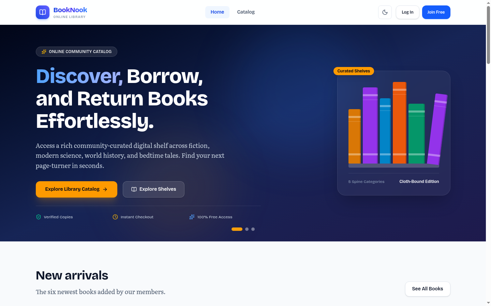
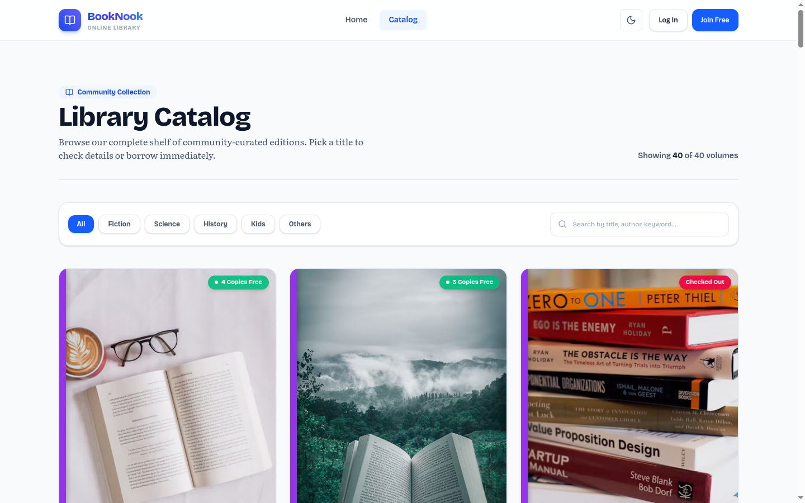
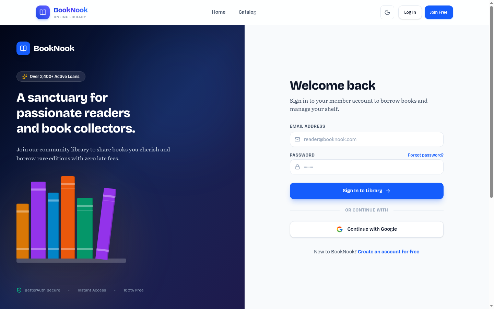

# 📖 BookNook – Modern Online Community Library

[](https://booknook-client-tau.vercel.app/)
[](https://booknook-server-ashy.vercel.app/books)
[-black?style=for-the-badge&logo=next.js)](https://nextjs.org/)
[](https://www.better-auth.com/)

A modern, full-stack community library application where book enthusiasts can discover literary works, borrow physical copies with real-time inventory management, share their personal collections, and track active loans.

Built with **Next.js (App Router)**, **TypeScript**, **Tailwind CSS v4**, **BetterAuth with JWT & JWKS**, and an **Express.js + MongoDB Atlas** backend service.

---

## 🌐 Live Production Links
* **Client Application**: [https://booknook-client-tau.vercel.app/](https://booknook-client-tau.vercel.app/)
* **Backend API**: [https://booknook-server-ashy.vercel.app/books](https://booknook-server-ashy.vercel.app/books)

---

## 📸 Website Previews & Screenshots

### 1. Editorial Magazine Home & Swiper Hero
> Interactive book showcase with dynamic gradients, real-time platform statistics, and smooth transitions.


<br />

### 2. Comprehensive 40-Volume Catalog with Category Filtering
> Browse 40 curated titles across Fiction, Science, History, Kids, and Others with dynamic search and stock indicators.


<br />

### 3. Book Details & Hardcover Presentation
> 3D book spine perspective, verified metadata, and atomic borrow modal with live stock validation.


<br />

### 4. Split-Screen Authentication & Google OAuth
> Secure Google Sign-In and credentials registration with live password rule verification.


---

## ✨ Key Features (60/60 Rubric Implementation)

- 📚 **Cloth-Bound Spine Design System**: A bespoke bookish design system where each category (*Fiction, Science, History, Kids, Others*) features its signature spine color applied to cards, category shelves, loaders, and footer strips with full Dark/Light theme switching.
- 🔄 **Atomic Borrowing with Duplicate Prevention**: Atomic `findOneAndUpdate` inventory decrement operations with `{ availableCopies: { $gt: 0 } }` and `$inc: -1`. Compound unique indexing on `{ bookId, userEmail }` strictly blocks duplicate borrows with HTTP 409 Conflict.
- 🛡️ **BetterAuth with Remote JWKS Token Verification**: Full authentication featuring credentials login, real-time password criteria validation (uppercase, lowercase, minimum 6 characters), Google OAuth 2.0 integration, and cryptographically verified JWT authorization via `jose` remote JWKS (`/api/auth/jwks`).
- ✍️ **Complete Library Management (CRUD)**: Authorized members can contribute books with ImgBB automated cover uploads, edit books with prefilled forms, and delete titles protected by custom `<ConfirmModal/>` dialogs and server-side ownership verification.
- 📖 **Member Dashboard & Smart Return System**: Track active loans on `/my-borrows`, view overdue indicators, and return borrowed copies with one click, automatically incrementing available stock copies on the shelf.
- 🚀 **Zero Flash & Frictionless Hydration**: Protected private routes gracefully retain authenticated sessions during full-page reloads using `<Loader/>` states rather than redirecting to `/login`. Smooth Swiper hero presentation with Framer Motion animations honoring `prefers-reduced-motion`.

---

## 🗄️ Database Catalog Overview

The library database is populated with **40 volumes** across all 5 official categories:

| Category | Count | Notable Volumes Included |
|---|---|---|
| **Fiction** | 8 | *1984*, *To Kill a Mockingbird*, *The Great Gatsby*, *Brave New World*, *Pride and Prejudice* |
| **Science** | 8 | *Cosmos*, *A Brief History of Time*, *The Gene*, *The Selfish Gene*, *Thinking in Systems* |
| **History** | 7 | *Sapiens*, *Guns, Germs, and Steel*, *The Silk Roads*, *SPQR*, *The Diary of a Young Girl* |
| **Kids** | 8 | *The Little Prince*, *The Hobbit*, *Charlotte's Web*, *Harry Potter*, *Matilda*, *Winnie-the-Pooh* |
| **Others** | 9 | *Atomic Habits*, *Thinking, Fast and Slow*, *The Psychology of Money*, *Meditations*, *Deep Work* |

---

## 🛠️ Tech Stack & Architecture

```
┌────────────────────────────────────────────────────────┐
│                   Next.js 16 Client                    │
│      App Router · Tailwind CSS v4 · Framer Motion      │
└──────────────────────────┬─────────────────────────────┘
                           │
             BetterAuth    │ Bearer JWT Token
             (Next.js)     │ (Remote JWKS)
                           ▼
┌────────────────────────────────────────────────────────┐
│                   Express.js Server                    │
│            jose Remote JWKS · CORS · Node.js           │
└──────────────────────────┬─────────────────────────────┘
                           │
                           ▼
┌────────────────────────────────────────────────────────┐
│                  MongoDB Atlas Cluster                 │
│      Collections: books · borrows · users · sessions   │
└────────────────────────────────────────────────────────┘
```

### Client Technologies
* **Framework**: Next.js 16 (App Router with Turbopack)
* **Language**: TypeScript 5
* **Styling**: Tailwind CSS v4 design tokens (`@theme inline`)
* **Authentication**: BetterAuth with MongoDB adapter & Google OAuth
* **Icons & UI**: Lucide React, React Icons, Sonner toasts
* **Animations & Sliders**: Swiper.js & Framer Motion

### Server Technologies
* **Runtime**: Node.js & Express.js
* **Database**: MongoDB Atlas
* **Security & Auth**: `jose` (JSON Web Key Set verification)
* **Deployment**: Vercel Serverless Function

---

## ⚙️ Environment Variables

### Client (`booknook-client/.env.local`)
```env
MONGODB_URI=mongodb+srv://<username>:<password>@cluster.mongodb.net/booknook
BETTER_AUTH_SECRET=your_better_auth_secret_key
BETTER_AUTH_URL=https://booknook-client-tau.vercel.app
NEXT_PUBLIC_APP_URL=https://booknook-client-tau.vercel.app
GOOGLE_CLIENT_ID=your_google_client_id.apps.googleusercontent.com
GOOGLE_CLIENT_SECRET=your_google_client_secret
NEXT_PUBLIC_API_URL=https://booknook-server-ashy.vercel.app
NEXT_PUBLIC_SERVER_URL=https://booknook-server-ashy.vercel.app
NEXT_PUBLIC_IMGBB_API_KEY=your_imgbb_api_key
```

### Server (`booknook-server/.env`)
```env
PORT=5000
MONGODB_URI=mongodb+srv://<username>:<password>@cluster.mongodb.net/booknook
CLIENT_URL=https://booknook-client-tau.vercel.app
```

---

## 🚀 Local Development Setup

1. **Clone the repository**:
   ```bash
   git clone https://github.com/annoying-anna/booknook-client.git
   cd booknook-client
   ```

2. **Install dependencies**:
   ```bash
   npm install
   ```

3. **Configure environment**:
   ```bash
   cp .env.example .env.local
   # Fill in MongoDB URI, Google OAuth, and server API URL
   ```

4. **Start the development server**:
   ```bash
   npm run dev
   ```
   Open [http://localhost:3000](http://localhost:3000) in your browser.

---

## 📝 License
This project is developed for educational and portfolio demonstration purposes.
